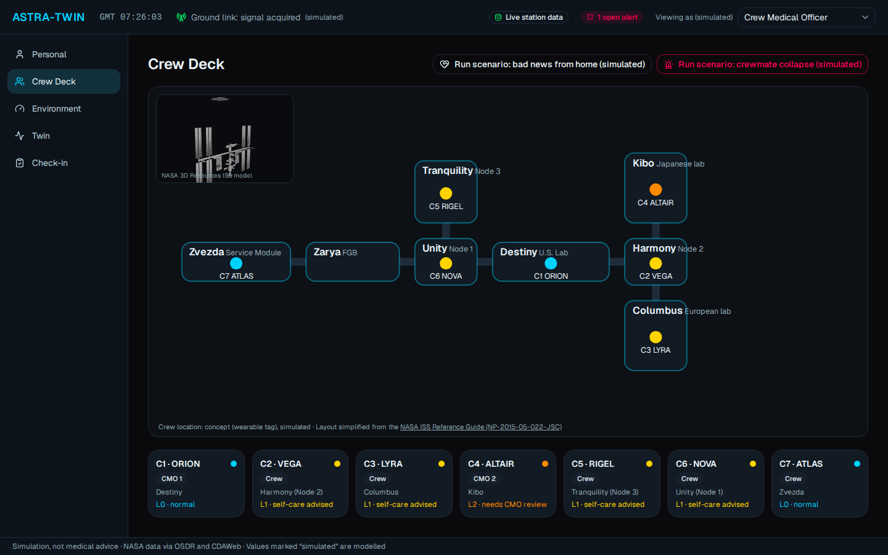
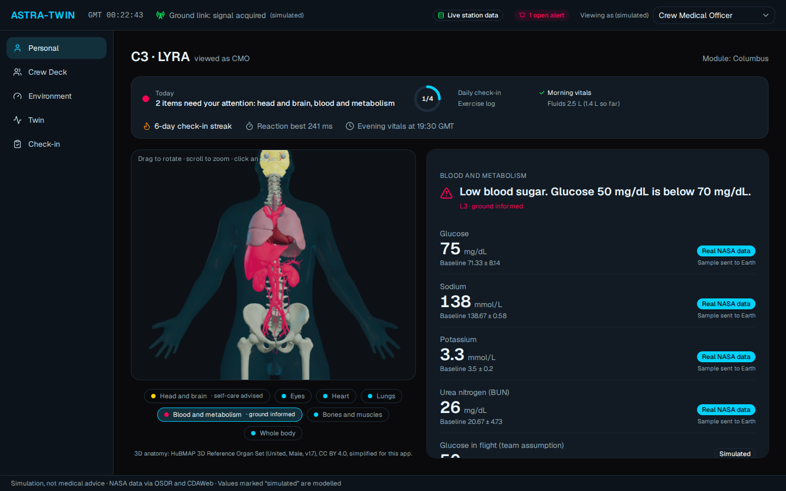
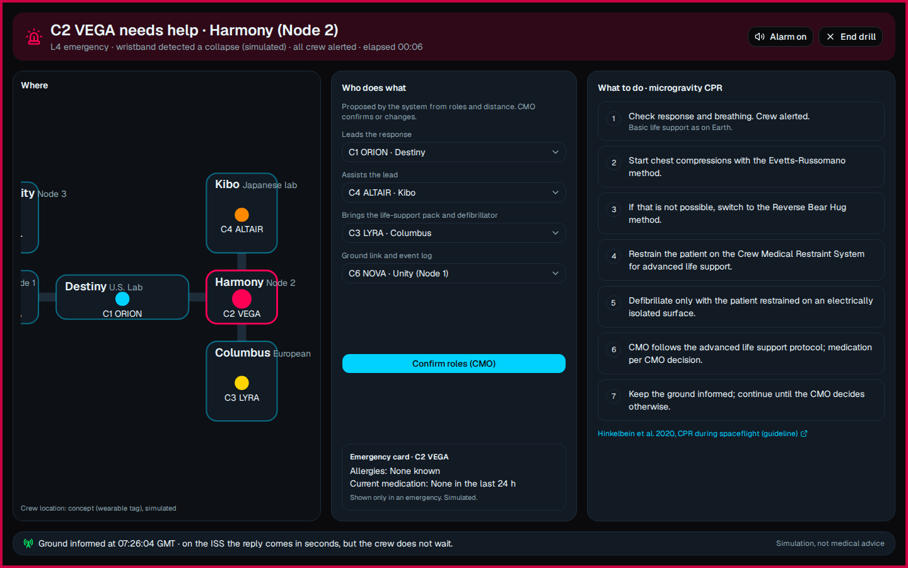
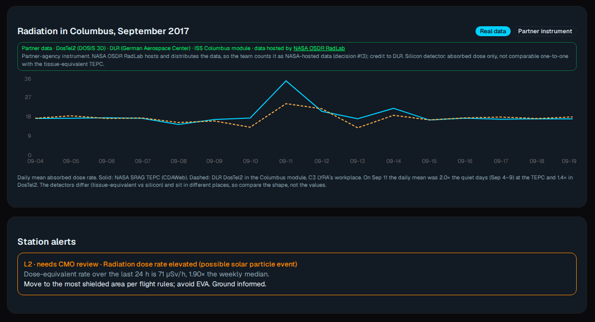
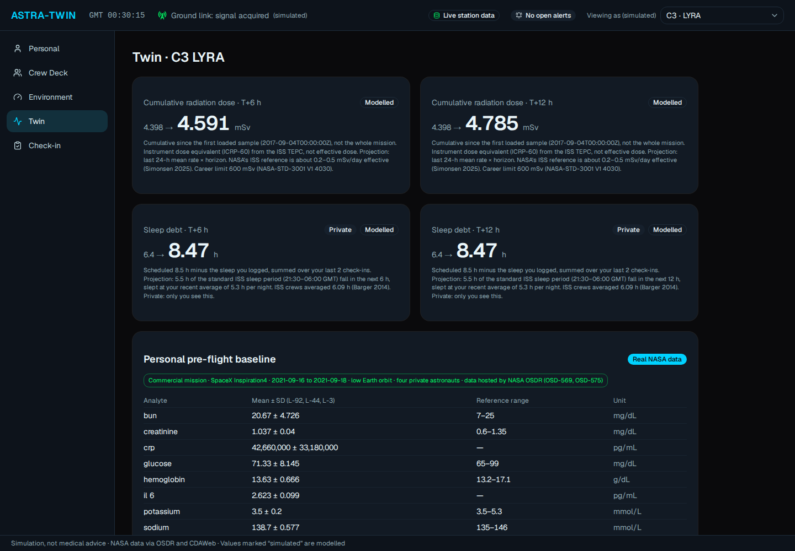
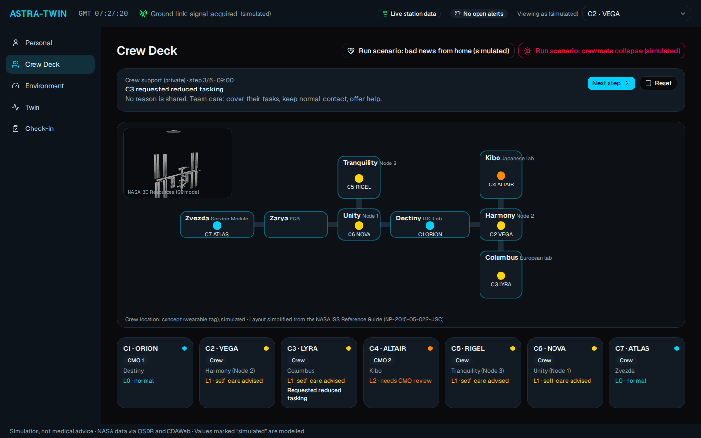
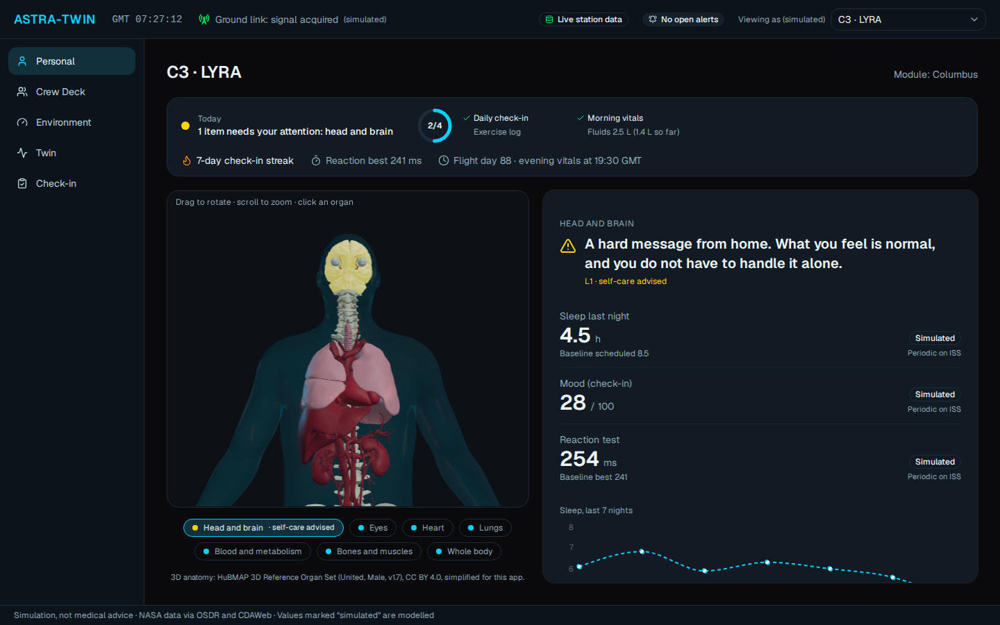
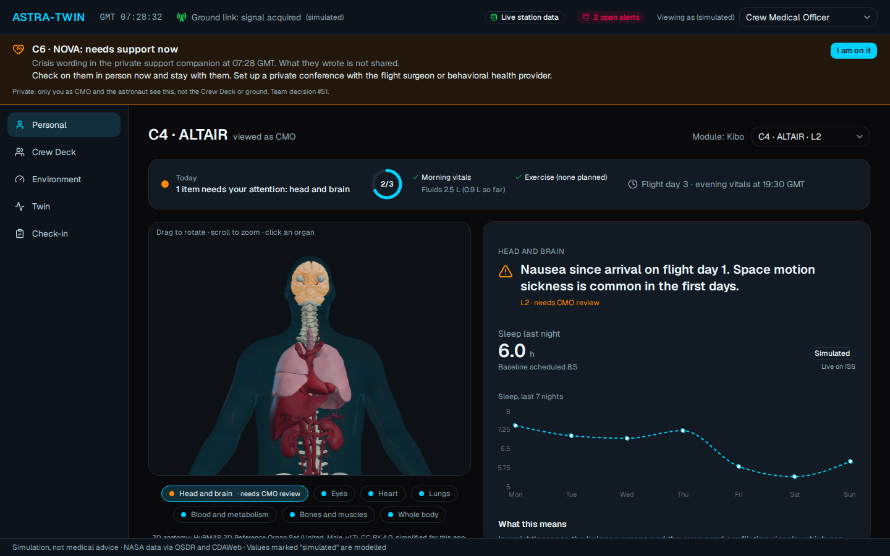

# ASTRA-TWIN

**ASTRA-TWIN helps ISS crews — who are not doctors — spot, understand and act on health changes in themselves and each other, using a digital twin built on real NASA data.**

NASA Space Apps Challenge 2026 · *Create Health Monitoring Software for Astronauts on Space Missions*

> Simulation, not medical advice. Values marked “simulated” are modelled.

Screenshots from the running app with the live backend (2026-11-15).

| Crew Deck | Personal twin |
|---|---|
|  |  |
| **Emergency: a crewmate collapses** | **Environment: real ISS radiation, Sep 2017 event** |
|  |  |
| **Partner data: radiation in Columbus** | **Earth twin: forecasts and a support plan** |
|  |  |
| **Bad news from home: what the crew sees** | **Bad news from home: what C3 sees** |
|  |  |
| **Private support companion** | **Crisis → CMO, without the message** |
|  |  |

## What it does

- **Personal twin.** A clickable body. Each region explains its values in plain language, with the person's own pre-flight baseline. Rule alerts light up the region, and each alert says what to do next and where the threshold comes from.
- **Crew Deck and emergency.** The whole crew on a map of the ISS modules. In an emergency it switches to who, where and who does what, plus the microgravity CPR checklist. The ground is informed, not awaited.
- **Environment.** Cabin CO2 limits, and real ISS radiation data, including the September 2017 solar particle event. The dose rule fires on Sep 11.
- **Earth twin.** A look-ahead slider to T+12 h over four forecasts, always labelled *modelled*: radiation dose from the real ISS data, sleep debt from the astronaut's private check-ins (only they see it), and simulated fluids and temperature. Plus the flight surgeon's Earth Twin plan, and forecast vs actual (the dose row is computed from the real data).
- **Privacy by design** (NASA-STD-3001 Vol 1, private medical and psychological communications). Each viewer sees only its tier: astronaut, CMO, ground, Crew Deck or emergency. Psychological check-ins and the support companion are private to the astronaut and never reach the Crew Deck. Crisis wording in the companion alerts the CMO (who and when, never the message). In the *bad news from home* scenario, the astronaut gets private support steps, the CMO and ground approve a 24–72 h support plan, and the Crew Deck sees only "C3 requested reduced tasking".
- **Private support companion.** A local language model (Ollama, phi3.5) with a safety gate and an output filter. It works offline and never leaves the station. It knows the astronaut's own profile (personality, hobbies, what helps them, faith or none, worries) and their last 3 days of check-ins and vitals, and adapts: meditation for one, prayer for another, never a faith someone does not have. *About you* shows exactly what it knows.
- **Live telemetry** as a CSV stream, in and out.

## NASA data

| Data | Use |
|---|---|
| NASA OSDR **OSD-575** and **OSD-569**: blood panels of the SpaceX Inspiration4 crew | Personal pre-flight baselines (42 analytes). Shown with a *commercial mission* tag: SpaceX Inspiration4, 16–18 Sep 2021, low Earth orbit, data hosted by NASA OSDR. |
| NASA SRAG ISS TEPC dose data, via **CDAWeb** `ISS_DOSANL_TEPC` | Real ISS dose rate and dose equivalent, Sep 4–19 2017; the solar-particle-event scenario. |
| NASA **Integrated Medical Model** | Most likely conditions on a 6-month ISS mission. |
| NASA OCHMO technical briefs, NASA-STD-3001, NTRS evidence reports | Thresholds and countermeasures; every alert cites its source. |
| NASA ISS Reference Guide; NASA 3D Resources ISS model | Station map and 3D overview. |

**Space Agency Partner Data and Other References**

| Data | Use |
|---|---|
| DLR **DosTel2** (DOSIS 3D) in the ISS Columbus module, hosted by **NASA OSDR RadLab** | Real absorbed dose, Sep 4–19 2017, next to the NASA TEPC: the Sep 11 event shows in both. Shown with a *partner data* tag; credit to DLR. |
| Diaz et al. 2024, *npj Microgravity* 10:76, ISS medical kit list (CC BY 4.0) | The only drugs the app names, always as a recommendation for the CMO to approve. |

Data that a NASA archive hosts and curates counts as NASA data for this team (decision #13); each such value names its mission or instrument team.

Full inventory: [`NASA_DATA_SOURCES.md`](NASA_DATA_SOURCES.md). The 3D anatomy comes from HuBMAP (NIH), CC BY 4.0: [`frontend/public/models/ATTRIBUTION.md`](frontend/public/models/ATTRIBUTION.md).

**What is simulated:** no public dataset has in-flight vital signs, so heart rate, SpO2, temperature, blood pressure and in-flight glucose are simulated around each person's baseline and labelled. Crew callsigns are fictional.

## Run it

```sh
# Full app: build the frontend once (Node.js), then start the API (Java 21, no other dependencies)
cd frontend && npm ci && npm run build && cd ..
backend/api/run.sh                 # app: http://127.0.0.1:8080/   demo console: /demo/
```

- **Support companion (optional):** install [Ollama](https://ollama.com), then `ollama pull phi3.5`. Without it, a rule-based companion answers.
- **Desktop app:** `cd frontend && npm run tauri build` (Tauri v2; prerequisites in [`docs/FRONTEND.md`](docs/FRONTEND.md)).
- **Tests:** `backend/api/test.sh` (42 tests).
- **Companion evaluation against the model:** `backend/api/eval.sh`; report in [`backend/api/eval/REPORT.md`](backend/api/eval/REPORT.md).

## How it is built

```
data/raw, data/osdr ──► backend/ingest (Rust) ──► data/cache/*.json ──► backend/api (Java 21) ──► frontend (React + Tauri)
                                                                         rules · scenarios · twin
                                                                         privacy filter · CSV stream
                                                                         support companion (local LLM)
```

**How the frontend and backend connect**

- The UI asks the API for one viewer at a time and polls `GET /api/station?viewer=…` every 2 s. Viewers: `SELF&crewId=C3`, `CMO`, `GROUND`, `CREW_DECK`. The server filters every answer by that viewer's privacy tier, so the UI never receives data it may not show.
- Without the API, the UI switches to its mock data automatically and keeps retrying. The status bar says *Live station data* or *Mock data*. `VITE_USE_MOCK=true` forces mock data.
- Mock and live tell the same story. The backend seeds each crew member's vitals, check-ins and reported conditions from the same profiles as the mock data (`frontend/src/data/crewProfiles.ts`).
- The base URL is the same origin when the API serves the build (`run.sh`, on any port), otherwise `http://127.0.0.1:8080`.
- During development, run `backend/api/run.sh` and `cd frontend && npm run dev` side by side. The dev server runs on http://localhost:1420 and talks to the API on :8080.
- Routes: [`backend/README.md`](backend/README.md). Screen-by-screen wiring: [`docs/FRONTEND.md`](docs/FRONTEND.md) §10.

| Doc | What |
|---|---|
| [`docs/TECH_OVERVIEW.md`](docs/TECH_OVERVIEW.md) | Shared architecture and data model |
| [`docs/BACKEND.md`](docs/BACKEND.md), [`backend/README.md`](backend/README.md) | Backend design and API |
| [`docs/FRONTEND.md`](docs/FRONTEND.md) | Frontend design |
| [`docs/PITCH.md`](docs/PITCH.md) | 7-slide pitch |

## Team

Süleyman Erdem Şener · Mehmet Emin Yıldız · Duru Umman (Computer Engineering) · Mustafa Polat Güldağ (Nutrition and Dietetics)

## Use of SI

Code and research were developed with SI (AI) assistance, as disclosed in the submission's "Use of SI" field. The support companion uses a local language model at run time.

## License

[MIT](LICENSE)
