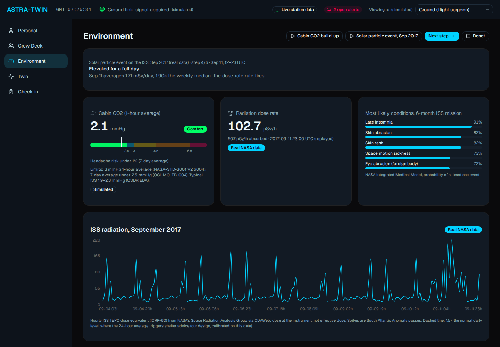
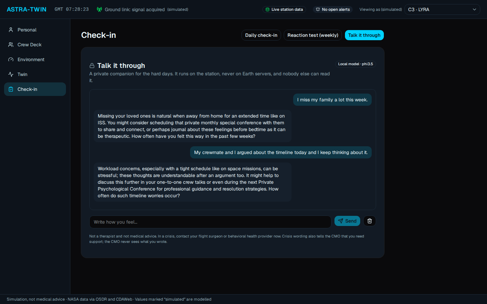

# ASTRA-TWIN

**ASTRA-TWIN helps ISS crews — who are not doctors — spot, understand and act on health changes in themselves and each other, using a digital twin built on real NASA data.**

NASA Space Apps Challenge 2026 · *Create Health Monitoring Software for Astronauts on Space Missions*

> Simulation, not medical advice. Values marked “simulated” are modelled.

| Crew Deck | Personal twin |
|---|---|
|  |  |
| **Emergency: a crewmate collapses** | **Environment: real ISS radiation, Sep 2017** |
|  |  |
| **Earth twin: forecasts and baselines** | **Private support companion** |
|  |  |

## What it does

- **Personal twin.** A clickable body. Each region explains its values in plain language, with the person's own pre-flight baseline. Rule alerts light up the region, and each alert says what to do next and where the threshold comes from.
- **Crew Deck and emergency.** The whole crew on a map of the ISS modules. In an emergency it switches to who, where and who does what, plus the microgravity CPR checklist. The ground is informed, not awaited.
- **Environment.** Cabin CO2 limits, and real ISS radiation data, including the September 2017 solar particle event. The dose rule fires on Sep 11.
- **Earth twin.** T+6 h and T+12 h forecasts of radiation dose and sleep debt, always labelled *modelled*. Sleep debt comes from the astronaut's private check-ins, so only they see it.
- **Privacy by design** (NASA-STD-3001 Vol 1, private medical and psychological communications). Each viewer sees only its tier: astronaut, CMO, ground, Crew Deck or emergency. Psychological check-ins and the support companion are private to the astronaut and never reach the Crew Deck.
- **Private support companion.** A local language model (Ollama, phi3.5) with a safety gate and an output filter. It works offline and never leaves the station.
- **Live telemetry** as a CSV stream, in and out.

## NASA data

| Data | Use |
|---|---|
| NASA OSDR **OSD-575** and **OSD-569**: blood panels of the SpaceX Inspiration4 crew | Personal pre-flight baselines (42 analytes). Shown with a *commercial mission* tag: SpaceX Inspiration4, 16–18 Sep 2021, low Earth orbit, data hosted by NASA OSDR. |
| NASA SRAG ISS TEPC dose data, via **CDAWeb** `ISS_DOSANL_TEPC` | Real ISS dose rate and dose equivalent, Sep 4–19 2017; the solar-particle-event scenario. |
| NASA **Integrated Medical Model** | Most likely conditions on a 6-month ISS mission. |
| NASA OCHMO technical briefs, NASA-STD-3001, NTRS evidence reports | Thresholds and countermeasures; every alert cites its source. |
| NASA ISS Reference Guide; NASA 3D Resources ISS model | Station map and 3D overview. |

Full inventory: [`NASA_DATA_SOURCES.md`](NASA_DATA_SOURCES.md). The 3D anatomy comes from HuBMAP (NIH), CC BY 4.0: [`frontend/public/models/ATTRIBUTION.md`](frontend/public/models/ATTRIBUTION.md).

**What is simulated:** no public dataset has in-flight vital signs, so heart rate, SpO2, temperature, blood pressure and in-flight glucose are simulated around each person's baseline and labelled. Crew callsigns are fictional.

## Run it

```sh
# Full app: build the frontend once (Node.js), then start the API (Java 21, no other dependencies)
cd frontend && npm ci && npm run build && cd ..
backend/api/run.sh                 # app: http://127.0.0.1:8080/   demo console: /demo/
```

- **Support companion (optional):** install [Ollama](https://ollama.com), then `ollama pull phi3.5`. Without it, a rule-based companion answers.
- **Desktop app:** `cd frontend && npm run tauri build` (Tauri v2; prerequisites in [`docs/FRONTEND.md`](docs/FRONTEND.md)).
- **Tests:** `backend/api/test.sh` (39 tests).
- **Companion evaluation against the model:** `backend/api/eval.sh`; report in [`backend/api/eval/REPORT.md`](backend/api/eval/REPORT.md).

## How it is built

```
data/raw, data/osdr ──► backend/ingest (Rust) ──► data/cache/*.json ──► backend/api (Java 21) ──► frontend (React + Tauri)
                                                                         rules · scenarios · twin
                                                                         privacy filter · CSV stream
                                                                         support companion (local LLM)
```

| Doc | What |
|---|---|
| [`docs/TECH_OVERVIEW.md`](docs/TECH_OVERVIEW.md) | Shared architecture and data model |
| [`docs/BACKEND.md`](docs/BACKEND.md), [`backend/README.md`](backend/README.md) | Backend design and API |
| [`docs/FRONTEND.md`](docs/FRONTEND.md) | Frontend design |
| [`docs/PITCH.md`](docs/PITCH.md) | 7-slide pitch |

## Team

Süleyman Erdem Şener · Mehmet Emin Yıldız · Duru Umman (Computer Engineering) · Mustafa Polat Güldağ (Nutrition and Dietetics)

## Use of SI

Code and research were developed with SI (AI) assistance, as disclosed in the submission's "Use of SI" field. The support companion uses a local language model at run time.

## License

[MIT](LICENSE)
